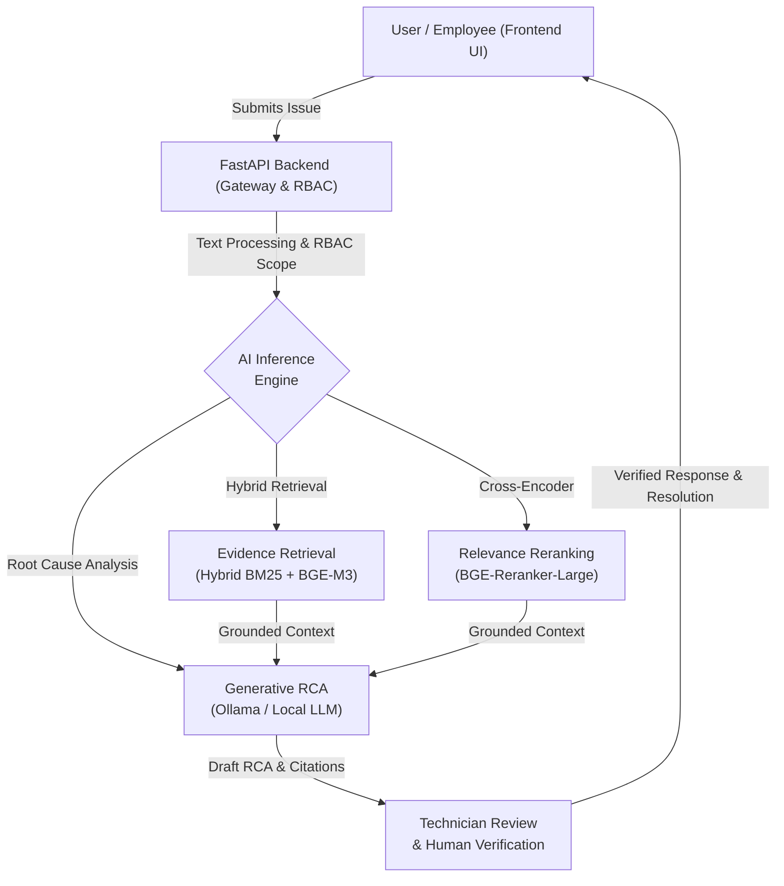

<div align="center">


<h1> AI-Driven IT Incident & Root Cause Analysis Platform </h1>


<br/>

[](https://opensource.org/licenses/MIT)
[](https://www.python.org/)
[](https://fastapi.tiangolo.com)
[](https://react.dev/)
[](https://www.docker.com/)

<br/><br/>

  <a href="http://localhost:8080">
    
  </a>
  &nbsp;&nbsp;
  <a href="http://localhost:8000/docs">
    
  </a>
  &nbsp;&nbsp;
  <a href="http://localhost:6333/dashboard">
    
  </a>
  &nbsp;&nbsp;
  <a href="http://localhost:3000">
    
  </a>

<br/><br/>
</div>

> [!NOTE] 
> ### Eliminating the Incident Response Bottleneck with Grounded AI
> **AI IT Helpdesk** kết hợp công nghệ **Hybrid RAG (BM25 + Dense BGE-M3)** cùng mô hình tái xếp hạng **Cross-Encoder** và cơ chế **Human-in-the-Loop**. Hệ thống phân tích sự cố IT, trích xuất log/runbook có liên quan, đề xuất nguyên nhân gốc rễ (RCA) kèm trích dẫn chứng cứ (evidence/citations) và chỉ gửi phản hồi tới người dùng khi đã được kỹ thuật viên phê duyệt.

<br/>

<div align="center">

## 📖 Navigation Hub

| 🎯 **Platform Vision** | 🏗️ **Under the Hood** | 🚀 **Quickstart & Ops** |
| :--- | :--- | :--- |
| ➧ [Why AI IT Helpdesk?](#why-ai-it-helpdesk)<br>➧ [Enterprise RBAC Matrix](#enterprise-rbac-matrix) | ➧ [System Architecture](#system-architecture)<br>➧ [The Hybrid RAG Pipeline](#the-hybrid-rag-pipeline) | ➧ [Docker Deployment](#docker-deployment)<br>➧ [Default Credentials](#default-credentials)<br>➧ [Roadmap](#roadmap) |

</div>

<br/>

> [!IMPORTANT]
> <h2 id="why-ai-it-helpdesk">🎯 Why AI IT Helpdesk?</h2>
> 
> Hệ thống được thiết kế giải quyết triệt để các hạn chế của Helpdesk truyền thống và các công cụ AI thông thường:
> 
> 1. **Zero-Hallucination with Grounded Evidence**: Không chỉ sinh văn bản dự đoán, AI bắt buộc phải trích xuất dẫn chứng cụ thể từ tài liệu Runbook SOP và Log hệ thống.
> 2. **Human-in-the-Loop Safety**: AI không tự động gửi câu trả lời chưa qua kiểm duyệt. Kỹ thuật viên (Technician) là người xác thực báo cáo RCA và duyệt nội dung phản hồi.
> 3. **Hybrid Search Supremacy (RRF Fusion)**: Khắc phục điểm yếu tìm kiếm từ khóa thuần túy hoặc vector thuần túy bằng cách kết hợp BM25 + BGE-M3 qua thuật toán Reciprocal Rank Fusion và Cross-Encoder Reranker.
> 4. **Enterprise-Grade Security**: Kiểm soát truy cập nghiêm ngặt theo vai trò (RBAC), bảo vệ chống Brute-Force lockout, che giấu dữ liệu nhạy cảm (PII Redaction) và phòng chống Prompt Injection.

---

<h2 id="enterprise-rbac-matrix">💎 Enterprise RBAC & Security Matrix</h2>

Hệ thống phân quyền 3 tầng với nguyên tắc đặc quyền tối thiểu (Least Privilege):

| Vai trò | Phân quyền & Khả năng tác vụ | Cơ chế bảo mật |
| :--- | :--- | :--- |
| **👑 Quản trị viên (Admin)** | Quản lý toàn bộ hệ thống, tạo và phân quyền Kỹ thuật viên, khóa/mở tài khoản, xem toàn bộ log kiểm toán (Audit Trail) và phê duyệt nhạy cảm. | Cookie `HttpOnly; SameSite=Strict`, giám sát đăng nhập thất bại. |
| **🛠️ Kỹ thuật viên (Technician)** | Xem hàng đợi sự cố, tiếp nhận ticket, kích hoạt phân tích AI RCA, kiểm tra bằng chứng, chỉnh sửa ghi chú, duyệt phản hồi và tạo tài khoản nhân viên. | Cách ly dữ liệu khách hàng/nội bộ, ghi nhận vết phê duyệt (Approval Audit). |
| **👤 Nhân viên (Employee)** | Đăng nhập an toàn, tạo yêu cầu hỗ trợ (Ticket), theo dõi trạng thái, nhận phản hồi chính thức từ Kỹ thuật viên và bổ sung trao đổi. | Đổi mật khẩu bắt buộc lần đầu, chỉ truy cập ticket của chính mình. |

---

<h2 id="system-architecture">🏗️ System Architecture</h2>

Hệ thống hoạt động theo mô hình vi dịch vụ tách rời (decoupled architecture) với quy trình xử lý dữ liệu và xác thực khép kín:



---

<h2 id="the-hybrid-rag-pipeline">🧠 The AI Neural & Hybrid RAG Pipeline</h2>

Hạ tầng AI xử lý sự cố sử dụng chuỗi tinh chỉnh đa tầng tối ưu hóa độ chính xác và tốc độ truy vấn:

<table width="100%">
  <tr>
    <td width="50%" valign="top">
      <h3>1. Hybrid Dense & Lexical Search</h3>
      <p>Kết hợp đồng thời <b>BM25</b> (bắt chính xác mã lỗi, IP, tên server) và vector embeddings đa ngôn ngữ <b>BGE-M3</b> lưu trữ trên <b>Qdrant Vector DB</b>.</p>
      <h3>2. Reciprocal Rank Fusion (RRF)</h3>
      <p>Tổng hợp và cân bằng điểm số giữa hai kênh tìm kiếm, giúp các tài liệu quan trọng nhất luôn được đẩy lên nhóm ứng viên hàng đầu.</p>
    </td>
    <td width="50%" valign="top">
      <h3>3. Cross-Encoder Re-ranking</h3>
      <p>Sử dụng mô hình <code>bge-reranker-large</code> chấm điểm tương quan ngữ nghĩa chuyên sâu giữa mô tả sự cố và từng phân đoạn runbook/log.</p>
      <h3>4. Grounded RCA & Citations</h3>
      <p>LLM sinh báo cáo phân tích nguyên nhân gốc rễ, đối chiếu mã định danh tài liệu và chỉ định các bước khắc phục có cơ sở rõ ràng.</p>
    </td>
  </tr>
</table>

---

<h2 id="docker-deployment">🚀 Docker Quickstart & Operations</h2>

Toàn bộ hệ sinh thái (Frontend, Backend, Database, Vector DB, Observability) được đóng gói sẵn sàng chạy qua Docker Compose.

### 1. Khởi động hệ thống
Từ thư mục gốc dự án:
```bash
# Khởi động cụm dịch vụ chính (Frontend + Backend + PostgreSQL + Qdrant)
docker compose -f infra/docker-compose.yml up -d --build

# (Tùy chọn) Bật thêm cụm giám sát Prometheus / Loki / Grafana
docker compose -f infra/docker-compose.yml --profile observability up -d --build
```

### 2. Danh mục cổng dịch vụ
| Dịch vụ | Địa chỉ truy cập | Tài khoản mặc định |
| :--- | :--- | :--- |
| **Frontend Web** | [http://localhost:8080](http://localhost:8080) | Xem bảng bên dưới |
| **Backend API (Swagger Docs)** | [http://localhost:8000/docs](http://localhost:8000/docs) | OpenAPI 3.0 Interactive Docs |
| **PostgreSQL Database** | `localhost:5432` | DB: `ai_it_helpdesk` / User: `postgres` |
| **Qdrant Vector DB** | [http://localhost:6333/dashboard](http://localhost:6333/dashboard) | Vector Search UI |
| **Grafana Monitoring** | [http://localhost:3000](http://localhost:3000) | Dashboard giám sát hiệu năng & log |

---

<h2 id="default-credentials">🔑 Default Credentials (Môi trường phát triển)</h2>

| Vai trò | Tên đăng nhập (Username) | Mật khẩu (Password) | Quyền hạn |
| :--- | :--- | :--- | :--- |
| **Quản trị viên (Admin)** | `admin` | `AdminSecure12345` | Quản trị tài khoản, phân quyền, toàn quyền hệ thống |
| **Kỹ thuật viên (Technician)** | `kythuatvien` | `Technician123@` | Nhận sự cố, chạy AI RCA, xác thực phản hồi, tạo nhân viên |
| **Nhân viên (Employee)** | `nhanvien261` | `Employee123456@` | Gửi ticket, theo dõi tiến độ, trao đổi với IT |

---

<h2 id="roadmap">🗺️ Roadmap & Milestones</h2>

- [x] **Phase 1**: Chuẩn hóa dữ liệu Ticket, Runbook SOP và Log Telemetry sự cố.
- [x] **Phase 2**: Thiết kế cơ chế Hybrid RAG (BM25 + BGE-M3) kết hợp RRF và Cross-Encoder Reranking.
- [x] **Phase 3**: Xây dựng AI RCA Engine với trích xuất Evidence và Citation bắt buộc.
- [x] **Phase 4**: Triển khai RBAC 3 tầng (Admin, Technician, Employee) với Session Cookie và cơ chế khóa tài khoản Brute-Force.
- [x] **Phase 5**: Quy trình phê duyệt Human-in-the-Loop & đóng gói toàn diện bằng Docker Compose.
- [ ] **Phase 6**: Tích hợp Webhook đồng bộ hai chiều với Slack / Microsoft Teams.
- [ ] **Phase 7**: Tự động kích hoạt Ansible Playbook / Runbook Script tự động khắc phục sau khi Kỹ thuật viên phê duyệt.

---

<div align="center">
Built with <span style="color:#10b981;">💚</span> by <strong>TanLee261</strong> • AI IT Helpdesk & Incident Assistant
</div>
