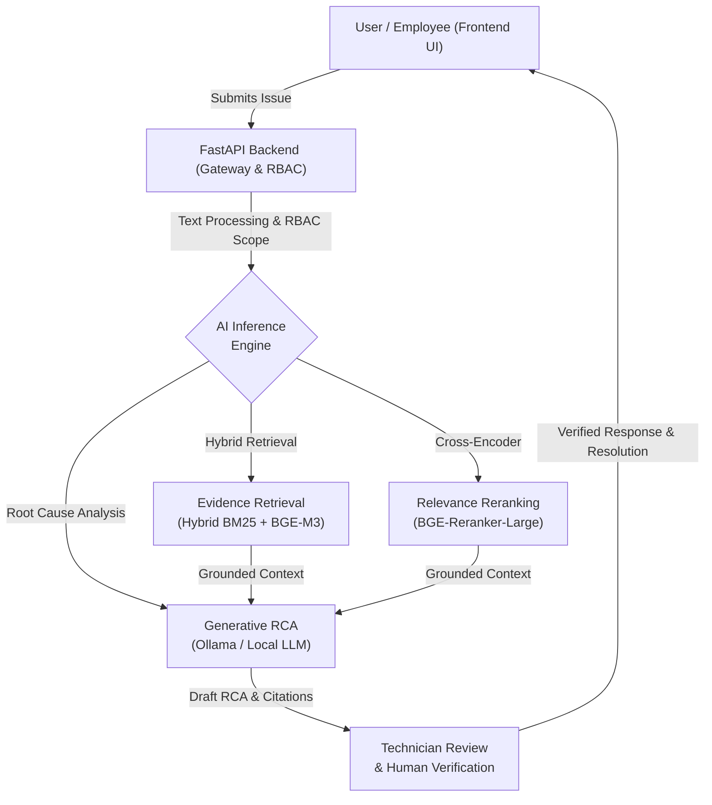

<div align="center">


<h1> AI-Driven IT Incident & Root Cause Analysis Platform </h1>


<br/>

[](https://opensource.org/licenses/MIT)
[](https://www.python.org/)
[](https://fastapi.tiangolo.com)
[](https://react.dev/)
[](https://www.docker.com/)

<br/><br/>

  <a href="http://localhost:8080">
    
  </a>
  &nbsp;&nbsp;
  <a href="http://localhost:8000/docs">
    
  </a>
  &nbsp;&nbsp;
  <a href="http://localhost:6333/dashboard">
    
  </a>
  &nbsp;&nbsp;
  <a href="http://localhost:3000">
    
  </a>

<br/><br/>
</div>

> [!NOTE] 
> ### Eliminating the Incident Response Bottleneck with Grounded AI
> **AI IT Helpdesk** unifies **Hybrid RAG (BM25 + Dense BGE-M3)** with **Cross-Encoder re-ranking** and an enterprise **Human-in-the-Loop** workflow. The system autonomously diagnoses IT incidents, retrieves relevant telemetry and runbooks, synthesizes grounded Root Cause Analysis (RCA) reports with verifiable citations, and mandates technician verification before dispatching resolutions to end users.

<br/>

<div align="center">

## 📖 Navigation Hub

| 🎯 **Platform Vision** | 🏗️ **Under the Hood** | 🚀 **Quickstart & Ops** |
| :--- | :--- | :--- |
| ➧ [Why AI IT Helpdesk?](#why-ai-it-helpdesk)<br>➧ [Enterprise RBAC Matrix](#enterprise-rbac-matrix) | ➧ [System Architecture](#system-architecture)<br>➧ [The Hybrid RAG Pipeline](#the-hybrid-rag-pipeline) | ➧ [Docker Deployment](#docker-deployment)<br>➧ [Default Credentials](#default-credentials)<br>➧ [Roadmap](#roadmap) |

</div>

<br/>

> [!IMPORTANT]
> <h2 id="why-ai-it-helpdesk">🎯 Why AI IT Helpdesk?</h2>
> 
> Modern IT organizations face massive alert fatigue and extended Mean Time to Resolution (MTTR). AI IT Helpdesk tackles these challenges directly:
> 
> 1. **Zero-Hallucination via Grounded Evidence**: Unlike conversational chatbots, our inference engine requires every claim and troubleshooting step to cite indexed SOPs, runbooks, and telemetry logs.
> 2. **Human-in-the-Loop Safety**: AI serves as an intelligence copilot, not an autonomous unchecked actor. Technicians inspect evidence citations, refine recommendations, and approve final responses.
> 3. **Hybrid Search Supremacy (RRF Fusion)**: Solves the blind spots of keyword-only or vector-only retrievers by unifying BM25 and multi-lingual BGE-M3 embeddings through Reciprocal Rank Fusion and Cross-Encoder re-ranking.
> 4. **Enterprise-Grade Security Hardening**: Enforces strict Role-Based Access Control (RBAC), brute-force lockout defenses, automated PII redaction, and prompt injection guards across all inference endpoints.

---

<h2 id="enterprise-rbac-matrix">💎 Enterprise RBAC & Security Matrix</h2>

The platform implements a 3-tier permission hierarchy following the principle of Least Privilege:

| Role | Scope & Primary Capabilities | Security Controls |
| :--- | :--- | :--- |
| **👑 Administrator** | Full system oversight, technician account provisioning, role assignment, account lock/unlock, global audit trail inspection, and approval governance. | Secure `HttpOnly; SameSite=Strict` session cookies, brute-force monitoring. |
| **🛠️ Technician** | Incident queue triage, ticket claiming, automated AI RCA execution, citation inspection, resolution note curation, and employee account creation. | Multi-tenant customer data isolation, audit-logged approvals. |
| **👤 Employee** | Ticket creation, self-service incident tracking, official technician response viewing, and bidirectional commentary. | One-time temporary password with mandatory initial password reset; isolated ticket scope. |

---

<h2 id="system-architecture">🏗️ System Architecture</h2>

Built on a clean, decoupled microservice architecture ensuring high modularity and operational resilience:



---

<h2 id="the-hybrid-rag-pipeline">🧠 The AI Neural & Hybrid RAG Pipeline</h2>

The multi-stage retrieval and inference pipeline achieves high precision and low retrieval latency:

<table width="100%">
  <tr>
    <td width="50%" valign="top">
      <h3>1. Hybrid Dense & Lexical Search</h3>
      <p>Simultaneously queries <b>BM25</b> (for exact error codes, hostnames, IP addresses) and dense multi-lingual <b>BGE-M3</b> vector embeddings stored in <b>Qdrant Vector DB</b>.</p>
      <h3>2. Reciprocal Rank Fusion (RRF)</h3>
      <p>Harmonizes keyword and semantic candidate ranks into a balanced pool, ensuring both domain-specific jargon and broad semantic context are captured.</p>
    </td>
    <td width="50%" valign="top">
      <h3>3. Cross-Encoder Re-ranking</h3>
      <p>Applies <code>bge-reranker-large</code> over the candidate pool to compute fine-grained relevance cross-attention scores between ticket symptoms and runbook segments.</p>
      <h3>4. Grounded RCA & Citations</h3>
      <p>The generative LLM synthesizes an incident postmortem, citing document IDs and concrete runbook steps while maintaining audit traceability.</p>
    </td>
  </tr>
</table>

---

<h2 id="docker-deployment">🚀 Docker Quickstart & Operations</h2>

The entire stack (Frontend, Backend, PostgreSQL, Qdrant Vector DB, Observability) is orchestrated via Docker Compose.

### 1. Launch Services
From the repository root:
```bash
# Start core services (Frontend, Backend, PostgreSQL, Qdrant)
docker compose -f infra/docker-compose.yml up -d --build

# (Optional) Launch with full observability stack (Prometheus + Loki + Grafana)
docker compose -f infra/docker-compose.yml --profile observability up -d --build
```

### 2. Service Endpoints Directory
| Service | Access URL | Description |
| :--- | :--- | :--- |
| **Frontend Web Application** | [http://localhost:8080](http://localhost:8080) | React 18 / Vite single-page application served via Nginx |
| **Backend API (Swagger UI)** | [http://localhost:8000/docs](http://localhost:8000/docs) | Interactive OpenAPI 3.0 specification |
| **PostgreSQL Database** | `localhost:5432` | Relational store (`DB: ai_it_helpdesk`, `User: postgres`) |
| **Qdrant Vector DB** | [http://localhost:6333/dashboard](http://localhost:6333/dashboard) | Vector search engine dashboard |
| **Grafana Monitoring** | [http://localhost:3000](http://localhost:3000) | Observability dashboards & metrics |

---

<h2 id="default-credentials">🔑 Default Credentials (Development Environment)</h2>

| Role | Username / Identity | Password | Permissions & Notes |
| :--- | :--- | :--- | :--- |
| **Administrator** | `admin` | `AdminSecure12345` | Global governance, technician provisioning, audit trails |
| **Technician** | `kythuatvien` | `Technician123@` | Incident triage, AI RCA execution, ticket verification |
| **Employee** | `nhanvien261` | `Employee123456@` | Ticket submission, self-service tracking |

---

<h2 id="roadmap">🗺️ Roadmap & Milestones</h2>

- [x] **Phase 1**: Incident dataset standardization, runbook SOP ingestion, and telemetry synthesis.
- [x] **Phase 2**: Hybrid RAG engine implementation (BM25 + BGE-M3) with RRF and Cross-Encoder re-ranking.
- [x] **Phase 3**: Automated RCA generator with mandatory evidence validation and citation scoring.
- [x] **Phase 4**: 3-tier RBAC architecture (Admin, Technician, Employee) with brute-force lockout defenses.
- [x] **Phase 5**: Human-in-the-Loop verification gate & full-stack containerization with Docker Compose.
- [ ] **Phase 6**: Bidirectional Slack and Microsoft Teams bot integration with alert webhooks.
- [ ] **Phase 7**: Automated remediation execution via Ansible playbooks following technician approval.

---

<div align="center">
Built with <span style="color:#10b981;">💚</span> by <strong>TanLee261</strong> • AI IT Helpdesk & Incident Assistant
</div>
