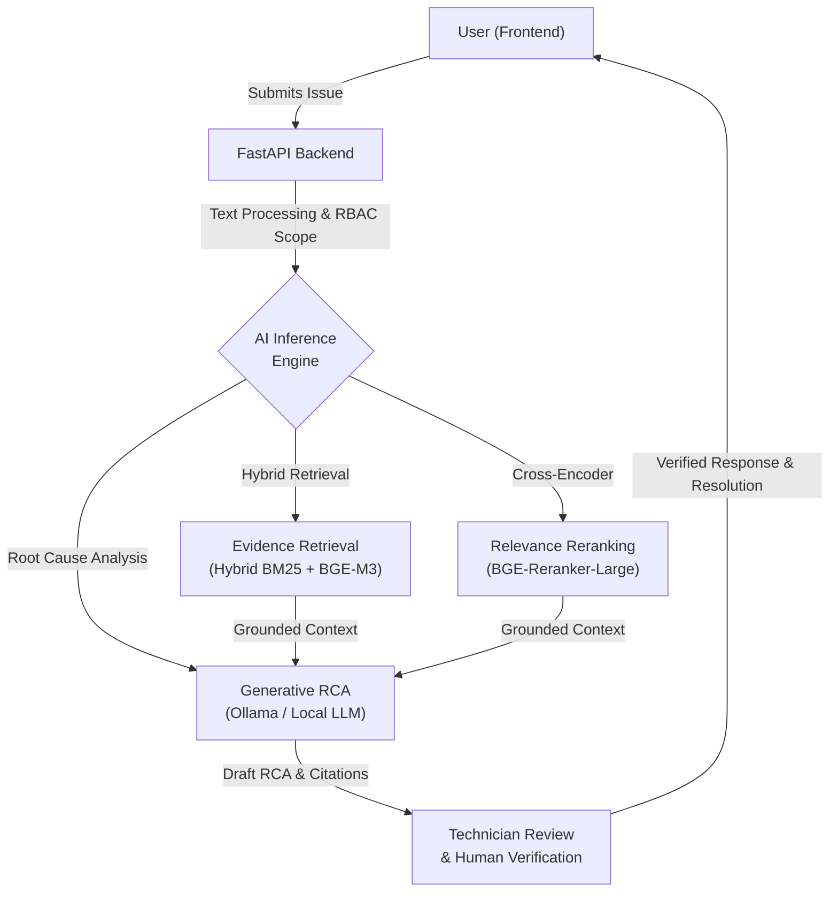

# AI IT Helpdesk & Incident Assistant

Hệ thống IT Helpdesk ứng dụng AI/Hybrid RAG hỗ trợ phân tích nguyên nhân gốc rễ sự cố (RCA) với cơ chế xác thực, phân quyền (RBAC), cách ly dữ liệu và yêu cầu kỹ thuật viên xác nhận trước khi phản hồi người dùng.

---

## 🏗️ System Architecture

Hệ thống AI IT Helpdesk được thiết kế theo kiến trúc tách rời (decoupled architecture) với quy trình **Human-in-the-Loop**: Kỹ thuật viên kiểm tra kết quả phân tích AI và xác thực bằng chứng (evidence/citations) trước khi phản hồi người dùng.



---

## 1. Cấu trúc cổng dịch vụ

| Dịch vụ | Địa chỉ | Ghi chú |
| --- | --- | --- |
| **Frontend Web** | [http://localhost:8080](http://localhost:8080) | Giao diện React / Vite qua Nginx |
| **Backend API Docs** | [http://localhost:8000/docs](http://localhost:8000/docs) | Swagger UI của FastAPI |
| **PostgreSQL** | `localhost:5432` | DB: `ai_it_helpdesk`, User: `postgres`, Pass: `postgres` |
| **Qdrant Vector DB** | [http://localhost:6333/dashboard](http://localhost:6333/dashboard) | Vector DB lưu trữ chunk tri thức |
| **Grafana** (Observability) | [http://localhost:3000](http://localhost:3000) | Dashboard logs & metrics (User: `admin`) |

---

## 2. Hướng dẫn chạy nhanh bằng Docker

### Bước 1: Khởi động các dịch vụ

Từ thư mục gốc dự án:

```bash
docker compose -f infra/docker-compose.yml up -d --build
```

*(Nếu muốn bật cả cụm giám sát Prometheus/Loki/Grafana:)*
```bash
docker compose -f infra/docker-compose.yml --profile observability up -d --build
```

### Bước 2: Tạo tài khoản Quản trị viên (Admin) đầu tiên

Sau khi container backend và database đã sẵn sàng, khởi tạo tài khoản quản trị:

```bash
docker exec -it ai-it-helpdesk-backend python -c "
import sys; sys.path.insert(0, '/app')
from app.db.models import User
from app.db.session import SessionLocal
from app.security.passwords import hash_password

with SessionLocal() as db:
    if not db.query(User).filter(User.role == 'admin').first():
        db.add(User(
            username='admin',
            email='admin@helpdesk.local',
            full_name='System Admin',
            role='admin',
            password_hash=hash_password('AdminSecure12345'),
            is_active=True,
            must_change_password=False
        ))
        db.commit()
        print('Created admin: admin / AdminSecure12345')
    else:
        print('Admin already exists.')
"
```

### Bước 3: Đăng nhập và sử dụng

1. Truy cập [http://localhost:8080](http://localhost:8080).
2. Đăng nhập với tài khoản:
   * **Username**: `admin`
   * **Password**: `AdminSecure12345`
3. Quản trị viên vào mục **User accounts** để tạo tài khoản cho Kỹ thuật viên (`technician`) hoặc Nhân viên (`employee`).
4. Nhân viên được cấp mật khẩu tạm ngẫu nhiên, khi đăng nhập lần đầu bắt buộc đổi mật khẩu trước khi tạo ticket.

---

## 3. Chế độ phát triển cục bộ (Development Mode)

Nếu muốn phát triển và sửa mã nguồn trực tiếp mà không cần build lại container:

```bash
# 1. Khởi động DB và Vector store qua Docker:
docker compose -f infra/docker-compose.yml up -d postgres qdrant

# 2. Khởi động Backend (Python):
cd backend
python -m venv .venv && source .venv/bin/activate
pip install -e .
alembic upgrade head
uvicorn app.main:app --reload --port 8000

# 3. Khởi động Frontend (React / Vite):
cd ../frontend
npm install
npm run dev
```

---

## 4. Kiểm thử

```bash
# Backend unit & security tests:
pytest backend/tests/ -v

# Frontend build check:
cd frontend && npm run build
```
